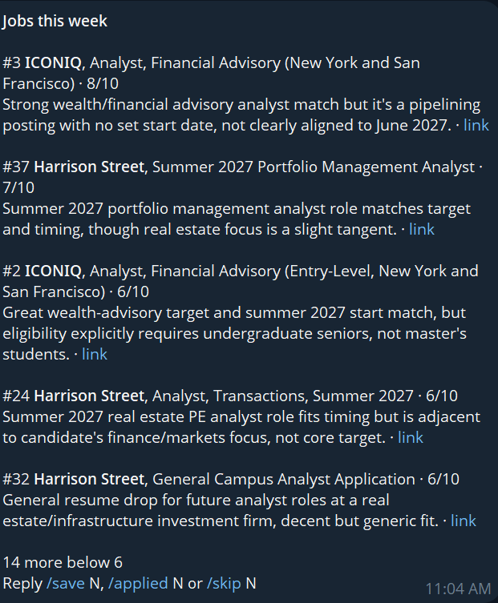

# JobScout

Weekly job finder: checks company job boards and Handshake alert emails, drops
obvious non-fits, has Claude score the rest against your profile, and sends a
compact Telegram digest. Strong matches closing within 7 days get an immediate
ping; saved jobs get a reminder 3 days before their deadline.



## How it works

```
Company job boards (ATS APIs) ─┐
                               ├─> rule filter ─> Claude scores vs. resume ─> SQLite ─> Telegram
Handshake alert emails (Gmail) ┘                                                    ^      |
                                                                  /save /applied /skip <───┘
```

1. **Collect.** Pulls postings from a watchlist of company job boards and
   parses Handshake alert emails through the Gmail API.
2. **Filter.** Cheap rules drop obvious non-fits (senior titles, years of
   experience required, non-U.S. locations) before any model call.
3. **Score.** Claude rates each remaining posting 1–10 against the resume and
   returns a one-line reason as structured output. Postings whose start date
   doesn't fit get their score capped.
4. **Deliver.** A weekly Telegram digest ranks the matches. Telegram replies
   (`/save`, `/applied`, `/skip`, `/rejected`) update the SQLite store, which
   drives the deadline pings and reminders.

**Stack:** Python 3.11, Claude API, Gmail API, Telegram Bot API, SQLite,
pydantic, uv, pytest.

## Setup

1. `uv venv --python "C:/Users/quint/AppData/Local/Programs/Python/Python311/python.exe"` then `uv sync`.
2. Copy `.env.example` to `.env`.
3. **Telegram:** create a new bot with @BotFather (keep it separate from the
   WheelTracker news bot, since this one reads replies). Put its token in
   `TELEGRAM_BOT_TOKEN`, send the bot any message, then open
   `https://api.telegram.org/bot<TOKEN>/getUpdates` and copy `message.chat.id`
   into `TELEGRAM_CHAT_ID`.
4. **Claude:** set `ANTHROPIC_API_KEY`.
5. **Resume:** keep your resume text in `profile/resume.md` (gitignored).
6. **Watchlist:** edit `watchlist.toml`, then check tokens with
   `uv run python -m jobscout.check`. For big employers, set `title_include`
   so only finance roles reach Claude.
7. **Handshake (optional):** in Handshake, save searches with email alerts on.
   In Google Cloud Console create a project, enable the Gmail API, configure the
   OAuth consent screen (External, add yourself as a test user), and create an
   OAuth client of type *Desktop app*. Download it as `credentials.json` into this
   folder, then run `uv run python -m jobscout.sources.handshake_mail auth`.
   Set `HANDSHAKE_ENABLED=false` to skip this source.

## Run

```
uv run python -m jobscout.weekly   # fetch, score, send digest
uv run python -m jobscout.hourly   # commands, resend, pings
```

Reply `/top` (or `/top 30`) for every scored open job, best first. Reply with `/save 12`, `/applied 12`, `/skip 12` or `/list`. After a rejection, `/rejected 12` (or `/rejected ICONIQ`) blocks that company from all future recommendations.

## Schedule (Windows Task Scheduler, times are this PC's local time)

```
schtasks /Create /TN "JobScout Weekly" /SC WEEKLY /D SUN /ST 18:00 /TR "wscript.exe \"C:\Users\quint\projects\JobScout\scripts\run_hidden.vbs\" run_weekly.cmd"
schtasks /Create /TN "JobScout Hourly" /SC HOURLY /ST 00:05 /TR "wscript.exe \"C:\Users\quint\projects\JobScout\scripts\run_hidden.vbs\" run_hourly.cmd"
```

Logs go to `jobscout.log`.
